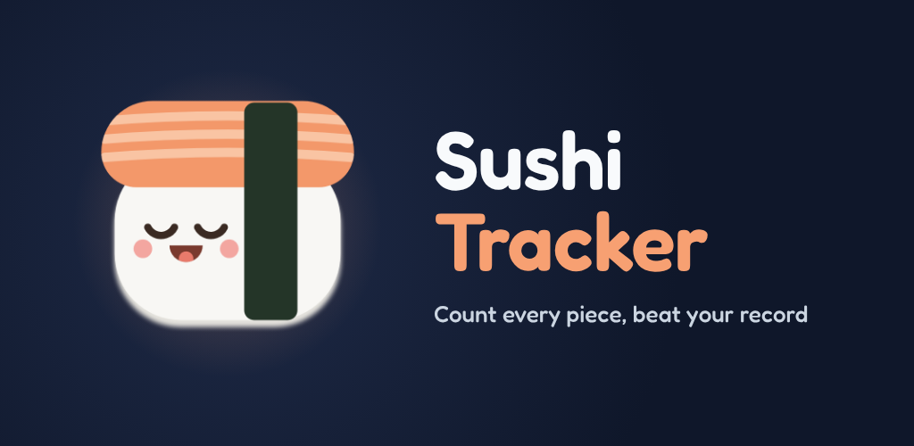
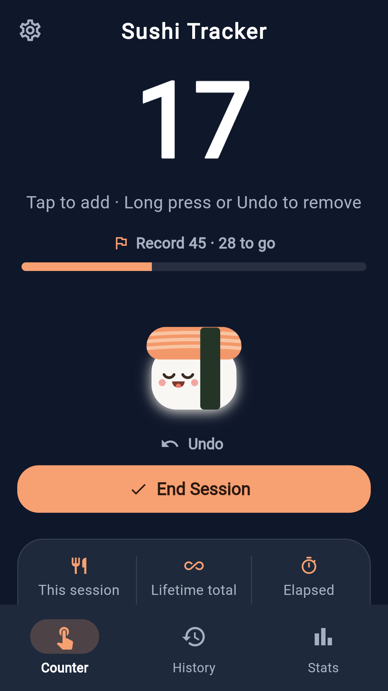
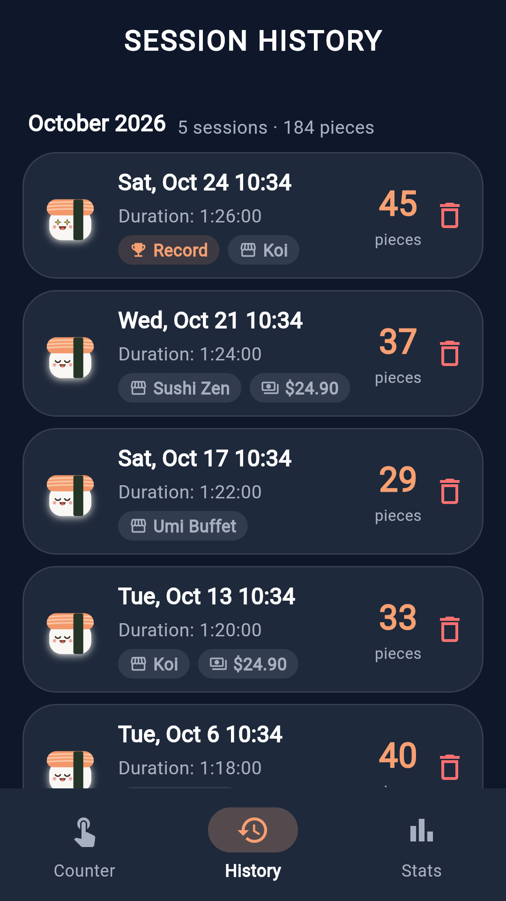
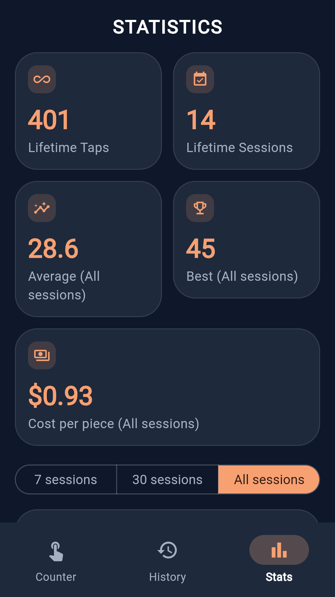
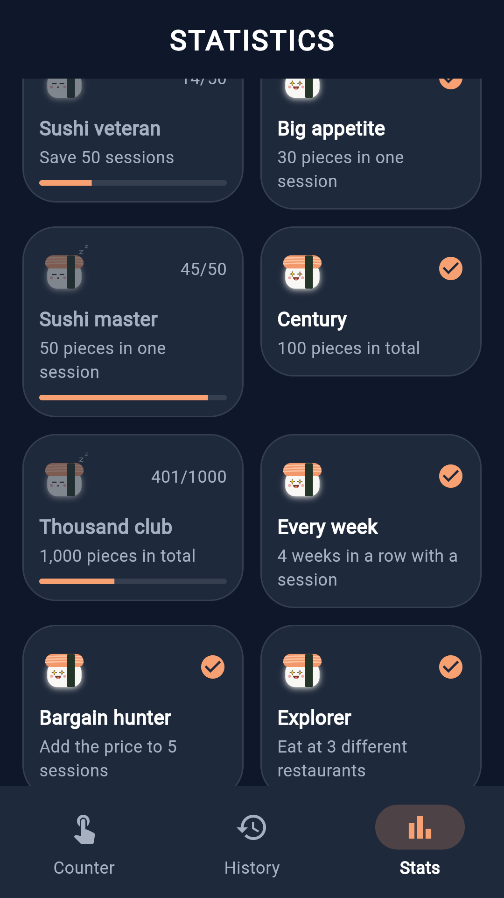

# 🍣 Sushi Tracker

A tiny, offline-first Flutter app for counting sushi pieces during a buffet.


<p align="center">
  
</p>

Tap to add a piece, use Undo or long-press to correct a count, and end the session when you're done. A live timer tracks session duration. History and lifetime statistics stay on your device. The app has no account, backend, ads, or analytics.

<p align="center">
  
  
  
  
</p>
<p align="center"><sub>Counter, History, Stats and Achievements (dark theme, sample data). A <a href="assets/play-store/screenshots/en/5-light.png">light theme</a> and <a href="assets/play-store/screenshots/es/">Spanish screenshots</a> are also available.</sub></p>

**Status:** version `0.7.0+12` (see [CHANGELOG.md](CHANGELOG.md)). Store graphics and a Google Play release checklist are in the repo ([PUBLISHING.md](PUBLISHING.md)).

## What it does

**Counter**, the home screen. Tap the sushi graphic to count, use visible Undo or long-press to decrement, and end the session to save it. It shows this session, the lifetime total including the active session, and a live elapsed timer, plus progress towards an optional session goal and your record, which gets a small celebration when you beat it. Friends at the same table can be counted too (up to eight), without touching your own totals. On Android, long-pressing the app icon offers "Add one sushi", which opens the app with one more piece counted, and a home screen widget shows the current count with a +1 button.

**History**, every past session, newest first and grouped by month, with its count, duration, and completion time. Tap one for details such as pace per minute, to record the restaurant and what the meal cost, to correct its pieces or start time, and to share it as an image. Sessions can be deleted and restored with Undo, including several deletes in a row.

**Stats**, lifetime taps and sessions, average and best session counts, cost per piece, records (best session, weekly streak, this month), a date-based trend chart for the latest 7 sessions, 30 sessions, or all sessions, pieces per week, a calendar of recent weeks shaded by pieces per day, per-restaurant sessions and averages (with the cheapest per piece), and ten achievements. Each chart can switch to a plain list for screen readers.

**Settings**, reset the current session or lifetime totals, choose a dark (default), light or system appearance, set a session goal, keep the screen on while counting, and export or import a backup file (clipboard on web and desktop). Lifetime reset is unavailable while a session is active and requires typing "RESET" (or "BORRAR" in Spanish) to confirm. It clears lifetime totals while preserving session history; Stats then cover the new lifetime and older sessions are marked in History.

The app is available in English and Spanish and follows the device language. Tablets and phones held sideways get a navigation rail and two-column layouts. Each tap gives light haptic feedback, so you can count without looking at the screen.

### Updating from an older version

Existing history is preserved. When upgrading, Sushi Tracker only links legacy history to lifetime totals if the old totals exactly match the saved sessions; otherwise it leaves the totals unchanged so deleting old history cannot accidentally change a later reset total.

## Under the hood

Nothing fancy, just a clean, feature-first structure so it's easy to find your way around:

- **State management**, [`flutter_riverpod`](https://pub.dev/packages/flutter_riverpod) `Notifier`s
- **Localization**, Flutter `gen-l10n` with ARB files in `lib/l10n` (run `flutter pub get` after editing them)
- **Local storage**, [`hive_ce`](https://pub.dev/packages/hive_ce) / `hive_ce_flutter` (the maintained continuation of Hive 2, same file format), so everything persists instantly with no server round-trip
- **Android integration**, small method channels in `MainActivity.kt` for keeping the screen on, the backup file picker, the launcher shortcut, the home screen widget and sharing a session image (served by a read-only content provider), with no extra plugins or runtime permissions
- **Charts**, [`fl_chart`](https://pub.dev/packages/fl_chart) for the trend line and the pieces-per-week bars on the Stats screen

```
lib/
├── core/       # models, theme, storage repository, backup, platform channels
├── features/   # counter, history, stats, and settings, each with its own views/providers
├── l10n/       # English and Spanish ARB files
└── shared/     # the nigiri artwork and widgets used across features (bottom nav, etc.)
```

## Running it locally

You'll need the [Flutter SDK](https://docs.flutter.dev/get-started/install) installed (CI uses Flutter 3.47.5).

```bash
git clone https://github.com/edulabrador/sushicounter.git
cd sushicounter
flutter pub get
flutter run
```

## Testing

```bash
flutter test                         # unit, widget and golden tests
flutter test --update-goldens test/goldens_test.dart   # after an intended visual change
flutter build apk --debug && flutter test integration_test   # the real app, on a device or emulator
(cd android && ./gradlew :app:testDebugUnitTest)   # Kotlin helpers, after one flutter build
```

CI (`.github/workflows/ci.yml`) checks formatting, runs `flutter analyze`, `flutter test` and the Kotlin unit tests, builds the web app, a debug APK and a validated release AAB, and runs the integration test on an Android emulator.

<details>
<summary><strong>Icons and store graphics</strong></summary>

The launcher icon, adaptive icon, native splash and store icon are drawn from the same nigiri the app uses:

```bash
flutter test tool/icons/render_icons_test.dart   # renders assets/icon/*.png and the store icon
python3 tool/icons/make_monochrome.py            # themed-icon silhouette
dart run flutter_launcher_icons                  # Android and iOS launcher icons
```

Play Store screenshots (`assets/play-store/screenshots/{en,es}/`) and the feature graphics are rendered with Playwright; see the comments in `tool/store/`.

</details>

## Building for Android

```bash
flutter build apk --debug
```

The local debug APK appears at `build/app/outputs/flutter-apk/app-debug.apk`.
For a signed Play Store app bundle, see [PUBLISHING.md](PUBLISHING.md). The privacy policy source is [`docs/privacy-policy.html`](docs/privacy-policy.html).

## License

All rights reserved. See [LICENSE](LICENSE). You're welcome to read the code, but reuse or redistribution requires my permission.
